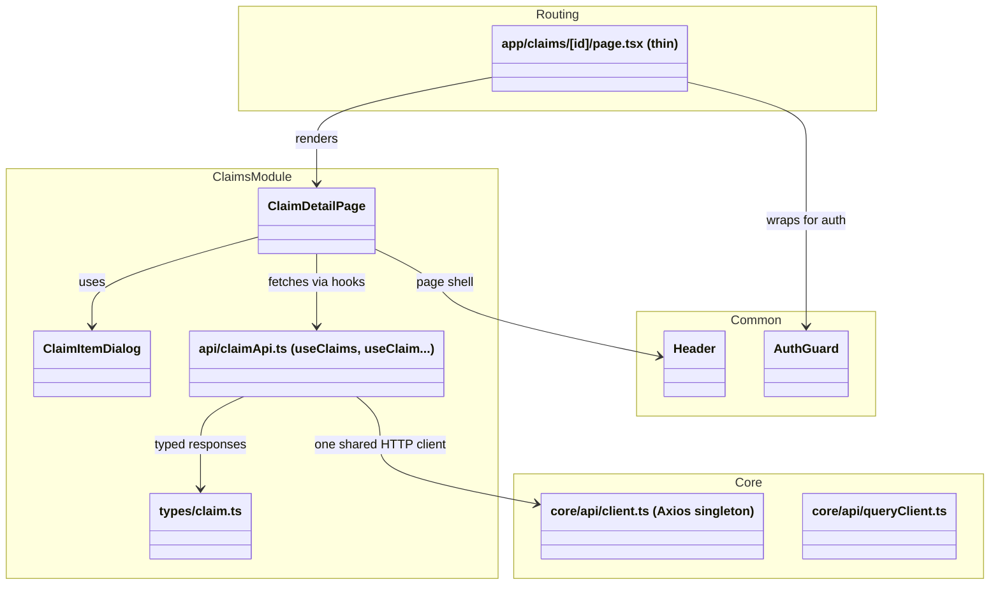
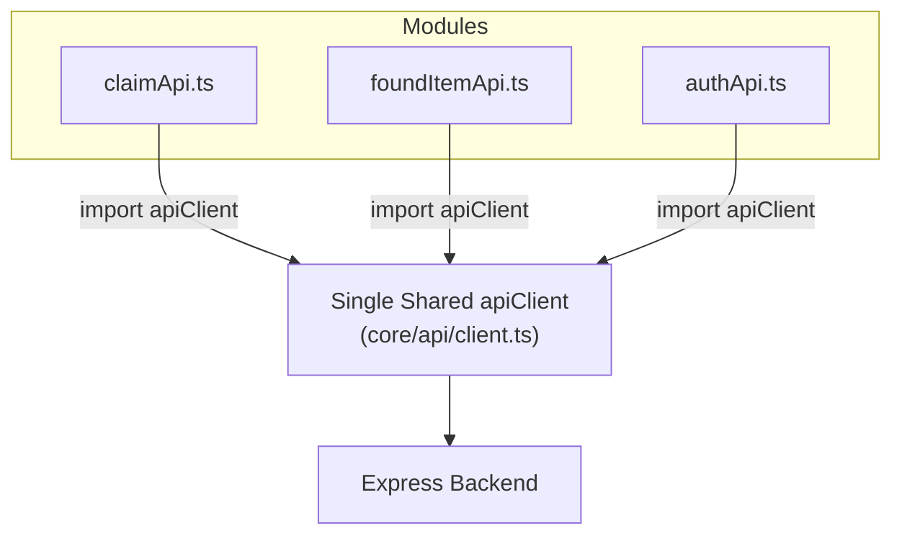
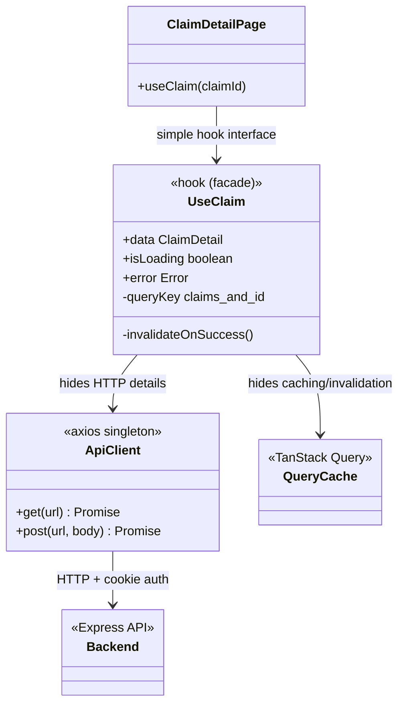
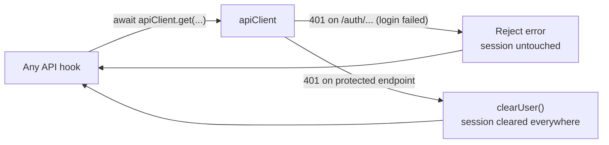
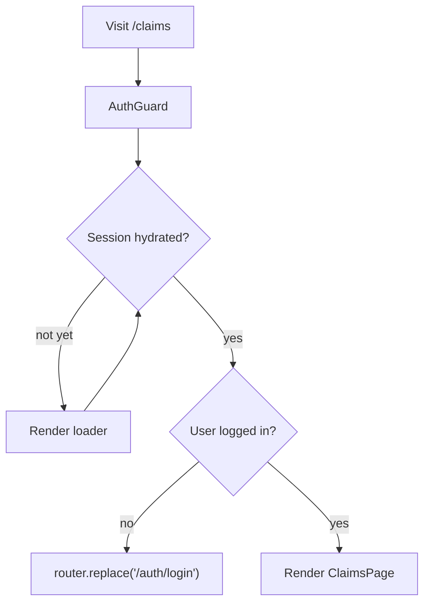

# Software Design Patterns in TrackBack Frontend

This document is about the **Design Patterns and Architectural Patterns** used in the **TrackBack Frontend**, mirroring the backend's `design-patterns.md`. Only patterns directly visible in the code are listed.

---

## 1. Feature-Based Modular Architecture (Vertical Slices)

### Core Idea
**Lego Analogy:** the app is built from self-contained feature blocks. Everything a feature needs — its pages, components, API hooks, and types — lives in one folder, and features never reach into each other's internals.

### The Problem Without It
A "technical" split (`components/`, `hooks/`, `services/`, `types/` at the top level) scatters one feature across the whole tree. Adding claims means touching six folders, and any feature can import any other feature, so dependencies grow sideways until nothing can be changed safely.

### How TrackBack Implements It
`src/modules/{feature}/` is a vertical slice: `pages/`, `components/`, `api/`, `types/`, `hooks/`, `store/`. Routing (`src/app/`), shared infrastructure (`src/core/`), and shared UI (`src/common/`) live outside the features with a one-way dependency rule: modules may use `core/` and `common/`; `core/` never imports from `modules/`.

### Class Diagram



### Why it pays off
- **Modularity & cohesion:** a feature can be added or removed without touching unrelated features.
- **Team scalability:** claims, notifications, and profile work mostly stays in one folder each — fewer merge conflicts.
- **Consistency:** every feature copies the same shape instead of inventing structure.

---

## 2. Singleton Pattern (Creational Pattern)

### Core Idea
Create exactly one instance of an object and share it across the whole application.

### The Problem Without It
If every feature created its own Axios instance, the backend base URL, `withCredentials`, and interceptors would be configured in a dozen places. A 401 handler would fire per-instance, and swapping the API URL (dev vs. deployed) would mean editing every module.

### How TrackBack Implements It
`src/core/api/client.ts` creates **one configured Axios instance**. Thanks to ES Module caching, every API hook in every module imports the same `apiClient`. The same idea gives us one `QueryClient` configuration (`src/core/api/queryClient.ts`) and one Zustand store (`src/core/store/useAppStore.ts`).

### Flow Diagram



### Code Implementation (`src/core/api/client.ts`)

```typescript
import axios from "axios";
import { setupInterceptors } from "./interceptors";

// SINGLETON: one configured instance shared by every feature module
export const apiClient = axios.create({
  baseURL: process.env.NEXT_PUBLIC_API_URL ?? "http://localhost:8080",
  withCredentials: true, // HTTP-only cookie auth
  headers: { "Content-Type": "application/json" },
});

setupInterceptors(apiClient);
```

---

## 3. Facade Pattern (Structural Pattern)

### Core Idea
Hide messy implementation details behind a clean, high-level interface.

### The Problem Without It
Components would call Axios directly, hand-manage `isLoading`/`error` flags with `useEffect`, invent their own cache keys, and remember to invalidate the right queries after every mutation. That boilerplate would be copy-pasted into every page.

### How TrackBack Implements It
Each feature's `api/` layer (e.g. `src/modules/claims/api/claimApi.ts`) wraps the whole data flow — HTTP call, response typing, query key, caching, and invalidation — behind one custom hook. Components call `useClaims()` / `useClaim(id)` and read `{ data, isLoading, error }`; they never touch Axios.

### Class Diagram



### Code Implementation (`src/modules/claims/api/claimApi.ts`, simplified)

```typescript
// FACADE: component sees { data, isLoading, error } — nothing else
export function useSubmitClaim() {
  const queryClient = useQueryClient();

  return useMutation({
    mutationFn: async ({ foundItemPostId, payload, proofImage }) => {
      // upload proof photo first, then submit the claim with its URL
      // ... details hidden inside the hook ...
    },
    onSuccess: () => {
      // cache invalidation declared next to the mutation that changes data
      queryClient.invalidateQueries({ queryKey: ["claims"] });
      queryClient.invalidateQueries({ queryKey: ["found-items"] });
    },
  });
}
```

---

## 4. Provider Pattern (React Context)

### Core Idea
Supply a shared dependency once, at the top of the tree, so any component below can consume it without prop-drilling.

### How TrackBack Implements It
`src/core/providers/QueryProvider.tsx` wraps the app in the root layout and supplies the configured `QueryClient` (stale time, retry rules, no refetch on focus). Every hook in every module uses that one client implicitly.

### Code Implementation (`src/core/providers/QueryProvider.tsx`)

```typescript
export function QueryProvider({ children }: { children: ReactNode }) {
  // useState initializer = client created once per browser session, never re-created
  const [client] = useState(() => createQueryClient());

  return <QueryClientProvider client={client}>{children}</QueryClientProvider>;
}
```

---

## 5. Interceptor Pattern (Cross-Cutting Concern)

### Core Idea
Run logic for **every** request/response in one place instead of repeating it at every call site — the frontend analogue of the backend's middleware chain.

### The Problem Without It
Session expiry (a 401 from any protected endpoint) would need to be handled in every hook: check the status, clear the stored user, redirect to login. One forgotten spot means a broken "logged-out but still showing data" state.

### How TrackBack Implements It
`src/core/api/interceptors.ts` attaches a single Axios response interceptor to the shared client: on `401` from a protected endpoint it clears the stored session. Auth endpoints (`/auth/*`) are exempt — a failed login is not a session expiry.

### Flow Diagram



### Code Implementation (`src/core/api/interceptors.ts`)

```typescript
export function setupInterceptors(client: AxiosInstance): AxiosInstance {
  client.interceptors.response.use(
    (response) => response,
    (error: AxiosError) => {
      if (axios.isAxiosError(error) && error.response?.status === 401) {
        const isAuthEndpoint = error.config?.url?.includes("/auth/");
        if (!isAuthEndpoint) {
          useAppStore.getState().clearUser(); // one place, every request
        }
      }
      return Promise.reject(error);
    },
  );
  return client;
}
```

---

## 6. Guard Pattern (Protected Route Wrapper)

### Core Idea
Wrap a page in a component that decides whether its children may render — like a bouncer at the door. All protected pages get identical auth behavior for free (a Decorator applied at the routing layer).

### The Problem Without It
Every protected page would repeat: "wait for hydration → check the session → redirect to login → show a spinner while deciding". Slightly different copies drift apart, and one of them always flashes content before redirecting.

### How TrackBack Implements It
`src/common/components/AuthGuard.tsx` waits for the persisted session to hydrate, redirects anonymous visitors to `/auth/login`, and renders a loader until the decision is made. Route files just wrap their page: `<AuthGuard><ClaimsPage /></AuthGuard>`.

### Flow Diagram



### Code Implementation (`src/common/components/AuthGuard.tsx`, simplified)

```typescript
export function AuthGuard({ children }: { children: ReactNode }) {
  const router = useRouter();
  const user = useAppStore((state) => state.user);
  const mounted = /* hydration flag via useSyncExternalStore */;

  useEffect(() => {
    if (mounted && !user) router.replace("/auth/login"); // bouncer says no
  }, [mounted, user, router]);

  if (!mounted) return <LoaderCircle className="animate-spin" />;
  if (!user) return null; // redirect in flight, never flash protected content
  return <>{children}</>;
}
```

---

## Related docs

- `project-structure.md` — folder layout and the one-way dependency rule
- `API_PATTERNS.md` — copy-paste templates for the Facade hooks in section 3
- Backend `design-patterns.md` — the same idea set on the server side
